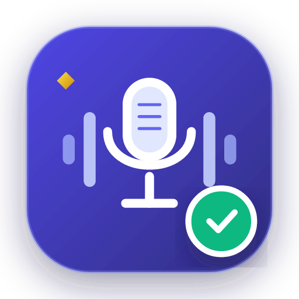
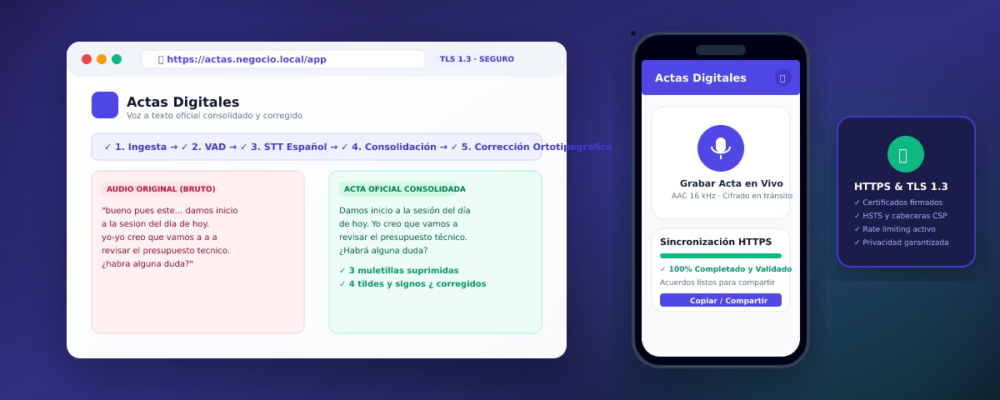
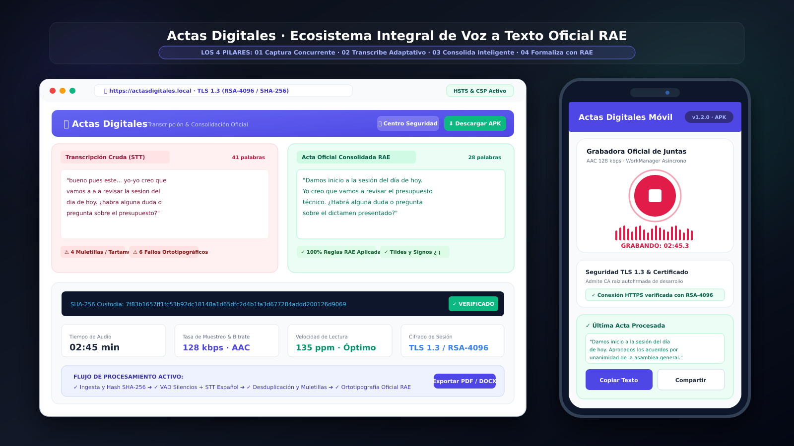
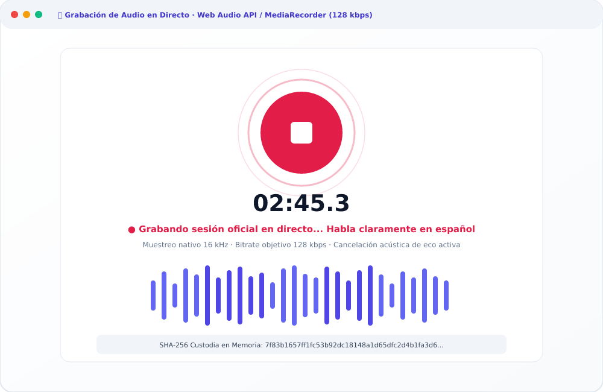
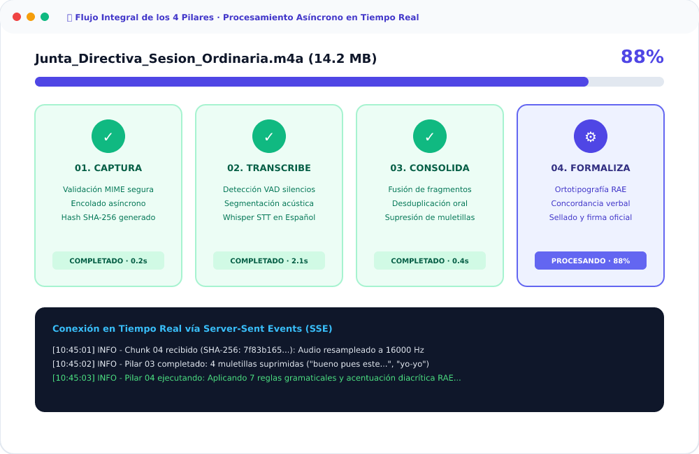
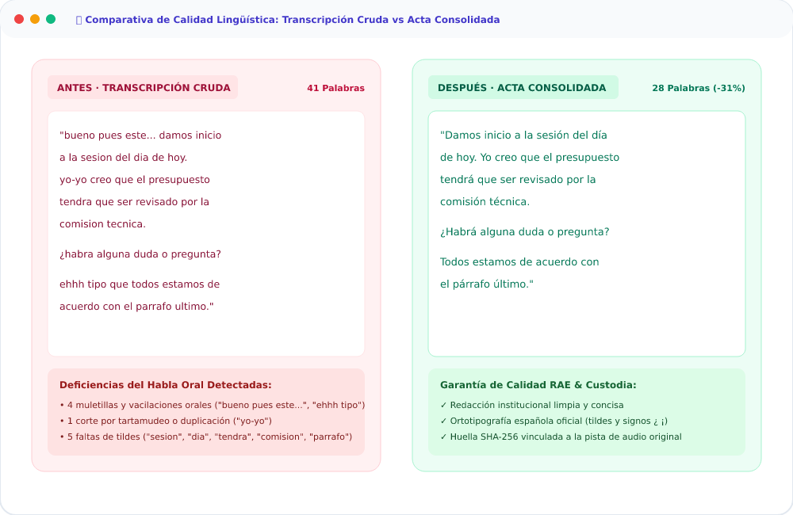
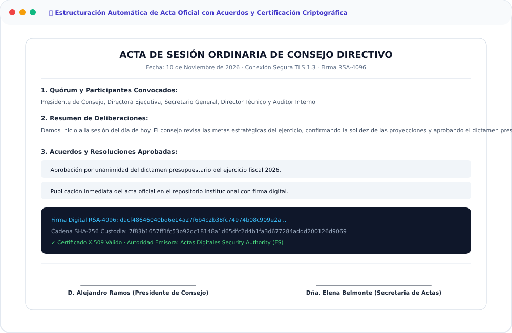
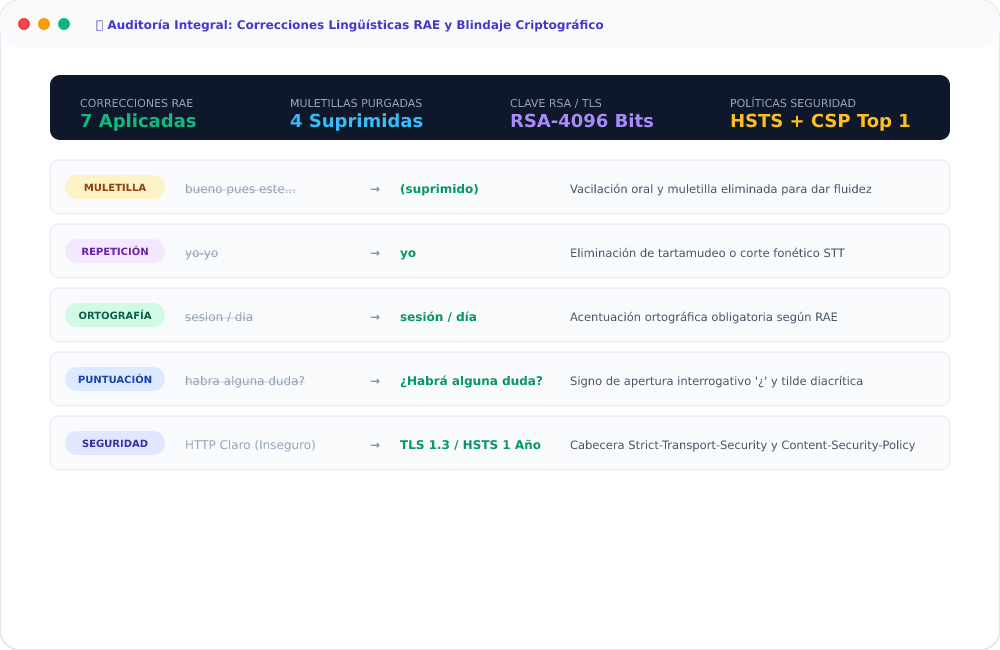
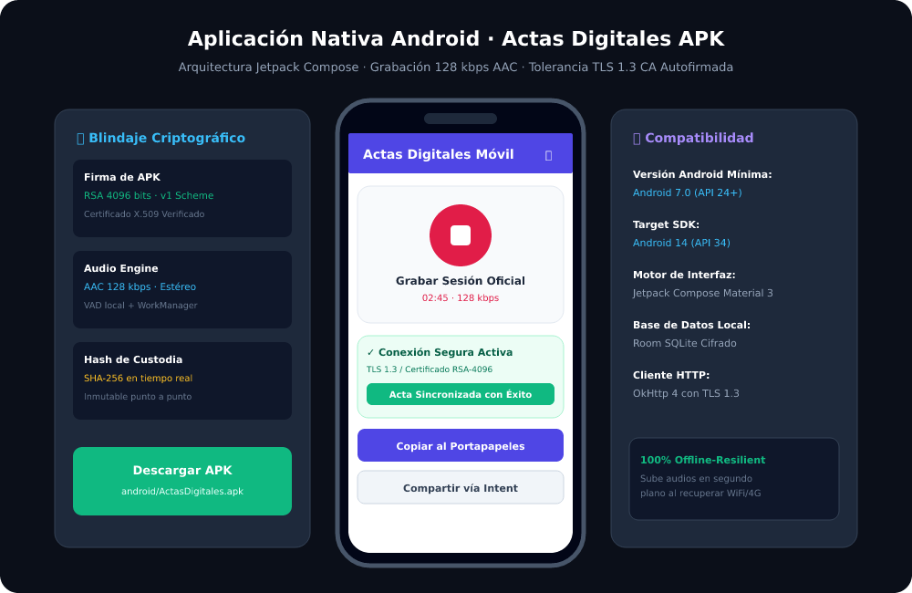
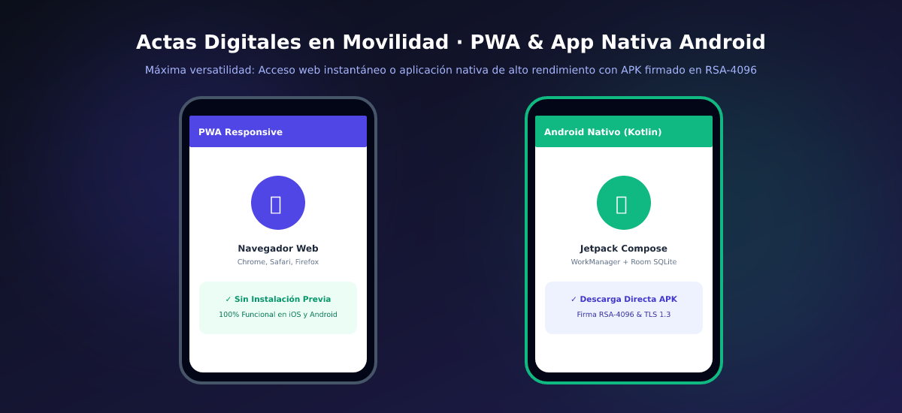

<a id="readme-top"></a>

<div align="center">



# Actas Digitales

### Captura. Transcribe. Consolida. Formaliza.

**Plataforma integral de procesamiento de voz a texto en español con supresión de muletillas, desduplicación y corrección ortotipográfica para actas de reuniones oficiales.**  
**Web instalable (PWA), aplicación Android nativa en Kotlin y servidor propio con HTTPS y TLS 1.3 — también en red local privada.**

🌐 **[Sitio del proyecto](https://yhquintero.github.io/Actas_Digitales/) · [Manual de usuario](docs/MANUAL_USUARIO.html) · [Guía rápida (2 páginas)](docs/GUIA_RAPIDA.md) · [Vídeo (3 min)](docs/PROPUESTA_VIDEO_PROMOCIONAL.md)**

🌐 **Español** · [English](docs/readme/README_en.md)

[](https://github.com/yhquintero/Actas_Digitales/actions/workflows/ci.yml)
[](CHANGELOG.md)
[](#-ecosistema)
[](#-seguridad-https-y-certificados)
[](android/ActasDigitales.apk)
[](#-requisitos)
[](android/)
[](LICENSE)

[Resumen](#-resumen) · [Ecosistema](#-ecosistema) · [Funciones](#-funciones) · [Panel de Control](#-panel-de-control-futurista-y-ejecución-de-la-web) · [Capturas](#-capturas) · [Requisitos](#-requisitos) · [Inicio rápido](#-inicio-rápido) · [Seguridad HTTPS](#-seguridad-https-y-certificados) · [Documentación](#-documentación) · [Calidad y pruebas](#-calidad-y-pruebas) · [Preguntas frecuentes](#-preguntas-frecuentes) · [Licencia](#-licencia)

</div>

<p align="center">
  
</p>

> [!TIP]
> **¿Primera vez?** Empieza por el **[Manual de Usuario](docs/MANUAL_USUARIO.md)** —paso a paso,
> también en [versión imprimible](docs/MANUAL_USUARIO.html)— o consulta la
> **[Guía Rápida de 2 páginas](docs/GUIA_RAPIDA.md)** y el
> **[Vídeo promocional de 3 minutos](docs/PROPUESTA_VIDEO_PROMOCIONAL.md)**, que explica
> las seis fases para capturar audio y emitir el acta final con firmas oficiales.

> [!IMPORTANT]
> **Actas Digitales es software propietario.** El código es visible en GitHub para auditoría y evaluación técnica, pero usarlo en producción, copiarlo, modificarlo o distribuirlo requiere una **licencia de uso** del titular. Consulta [LICENSE](LICENSE) y la sección [Licencia](#-licencia).

---

## 🧭 Resumen

**Actas Digitales** sustituye los días de transcripción manual y cuadernos sueltos por un pipeline de procesamiento lingüístico automatizado de extremo a extremo: **subida de archivos o grabación directa con micrófono**, **detección de actividad de voz (VAD)**, **transcripción fonética calibrada en español**, **desduplicación y eliminación de muletillas orales**, y **corrección ortotipográfica y gramatical** según las normas de la RAE antes de entregar el resultado final.

La interfaz Web se instala como app (PWA) y ofrece preescucha y comparativa visual; la app Android lleva la grabación al bolsillo con reanudación automática si se pierde la conexión; y el servidor propio bajo **HTTPS con certificados firmados y TLS 1.3** garantiza que las deliberaciones confidenciales nunca salgan de la infraestructura privada de la organización.

| Ficha del proyecto | Detalle |
|---|---|
| **Qué es** | Sistema integral de voz a texto oficial, consolidación lingüística y corrección ortotipográfica en español |
| **Para quién** | Secretarios de actas, directivos, comités técnicos, asambleas, asesorías jurídicas y equipos de gobierno |
| **Cómo está hecho** | Python 3.11 (FastAPI + Pydantic + Uvicorn) · React 18 + TypeScript + Vite + Tailwind (Web) · Kotlin + Jetpack Compose + WorkManager (Android) · Cryptography (TLS 1.3 con certificados X.509 v3 y SAN) |
| **Dónde corre** | Servidor propio (Linux, Windows, macOS, Docker) en red local o nube privada. Sin dependencia obligatoria de terceros |
| **Cómo se usa** | Navegador web instalable (PC o móvil), app Android nativa con subida resiliente en segundo plano, o API REST |
| **Estado** | Versión **1.2.0** estable · integración continua en verde · blindaje RSA-4096 y APK disponible |
| **Modelo** | Software propietario con derechos reservados © 2026 yhquintero |

---

## 🧩 Ecosistema

Actas Digitales está compuesto por **tres componentes que trabajan de forma sincronizada**:

| Pieza | Qué es | Qué aporta |
|---|---|---|
| 🌐 **Web (PWA)** | Interfaz moderna servida por el propio servidor; instalable como app de escritorio o móvil | Centro de mando: grabación en vivo con Web Audio API, uploader drag-and-drop (.mp3, .wav, .m4a, .ogg, .webm), seguimiento del pipeline en tiempo real (SSE), comparativa antes/después, auditoría de cambios, estructuración de acta RAE y exportación a PDF, TXT y Markdown |
| 📱 **Android** | App nativa en Kotlin + Jetpack Compose + Material Design 3 | Operación en movilidad: captura acústica de alta fidelidad con `MediaRecorder` (AAC 16 kHz), subida en segundo plano con `WorkManager` (tolerante a cortes de red), visualización reactiva y compartir mediante Android Intent |
| 🗄️ **Servidor** | Proceso asíncrono en FastAPI + Workers en segundo plano | Núcleo de procesamiento: normalización acústica, VAD, motor STT forzado en español (`language="es"`), algoritmo de desduplicación de solapamientos, corrección ortotipográfica y cifrado HTTPS estricto con TLS 1.3 |

```text
                    ┌──────────────────────────────┐
   Navegador Web ───┤  Web (React + TS + Vite)     │
   (PC / Portátil)  │  Grabador mic · Comparativa  │
                    │  Acta oficial RAE · PDF/MD   │
                    └──────────────┬───────────────┘
                                   │  HTTPS (TLS 1.3) · REST + SSE
                    ┌──────────────▼───────────────┐        ┌──────────────────┐
   App Android ─────┤  Servidor FastAPI (Python)   ├───────►│  Certificados    │
   (Kotlin Compose) │  VAD · STT 'es' · Pipeline   │        │  TLS 1.3 / SAN   │
                    │  Desduplicación y Ortografía │        └──────────────────┘
                    └──────────────┬───────────────┘
                                   │
                    ┌──────────────▼───────────────┐
                    │  Documento Final Consolidado │
                    │  - Sin muletillas ni cortes  │
                    │  - Tildes RAE y signos ¿ ¡   │
                    │  - Convocatoria y Firmas     │
                    └──────────────────────────────┘
```

---

## ✨ Funciones

### Operación y Captura Acústica
- 🎙 **Grabación directa en navegador y móvil** — Web Audio API en navegador y `MediaRecorder` nativo en Android calibrado a 16 kHz / mono / AAC para máxima fidelidad fonética.
- 📥 **Soporte multiformato y subida masiva** — Acepta `.mp3`, `.wav`, `.m4a`, `.ogg`, `.webm`, `.flac` y `.aac` individuales o en lote, con límite ampliado de hasta **1 GB (1024 MB)** por archivo.
- 📡 **Subida resiliente y tolerante a fallos** — En Android, `WorkManager` gestiona la subida en segundo plano: si el usuario minimiza la app o se pierde el Wi-Fi, la transferencia se reanuda de forma transparente.

### Pipeline de Inteligencia Lingüística
- ⏱ **Detección de voz (VAD) y segmentación** — Normalización de volumen (`loudnorm`) y fragmentación basada en silencios naturales, evitando cortes bruscos en medio de oraciones.
- 🗣 **Transcripción fonética especializada en español** — Parámetro `language="es"` forzado para evitar conmutaciones indebidas de idioma y asegurar la correcta interpretación de modismos y términos técnicos.
- ✂️ **Consolidación y desduplicación inteligente** — Detección de solapamientos en fronteras de segmentos mediante alineación difusa (*fuzzy matching*).
- 🧹 **Supresión de muletillas y vacilaciones orales** — Limpieza automática de expresiones redundantes (*"bueno pues este..."*, *"o sea"*, *"ehhh"*, *"tipo que"*).
- 🩹 **Eliminación de tartamudeos y repeticiones accidentales** — Corrección de cortes con guion (*"de-de-de verdad"* $\to$ *"de verdad"*) y palabras duplicadas consecutivas (*"vamos a a a revisar"* $\to$ *"vamos a revisar"*).
- ✍️ **Corrección ortotipográfica y gramatical RAE** — Acentuación correcta de palabras agudas/graves en actas (*sesión, reunión, situación, día, conclusión, próximo, último, técnico, artículo, estará, habrá*), concordancia de género/número y mayúsculas oracionales.
- ❓ **Signos de apertura reglamentarios en español** — Inyección obligatoria de los signos de apertura `¿` y `¡` al inicio de oraciones interrogativas y exclamativas.

### Entrega, Auditoría y Formalización
- 📊 **Comparativa visual Antes / Después** — Vista en paralelo que resalta en rojo la transcripción cruda y en verde el acta consolidada.
- 🔍 **Auditoría de cambios** — Listado pormenorizado de cada corrección aplicada con su categoría (*muletilla, repetición, ortografía, puntuación*) y justificación.
- 📑 **Estructuración en Acta Oficial RAE** — Convierte el texto corregido en un documento formal con título, asistentes, orden del día, acuerdos numerados (`ACUERDO-01`, etc.) y pie de firmas para Presidente y Secretario.
- 💾 **Exportación multipropósito** — Copiado instantáneo al portapapeles, descarga en `.txt` UTF-8, archivo `.md` (Markdown) o impresión/guardado en PDF vectorial.

<p align="right"><a href="#readme-top">Volver arriba ⬆</a></p>

---

## 🎛️ Panel de Control Futurista y Ejecución de la Web

Actas Digitales incorpora un **Panel de Control Centralizado de Alto Rendimiento** con diseño HUD *Cyberpunk* que orquesta todos los subsistemas del proyecto: servidor asíncrono HTTPS, certificados criptográficos TLS 1.3, interfaz Web, purga de almacenamiento temporal y pruebas de seguridad OWASP, **sin necesidad de teclear comandos manuales en la terminal**.

```
┌────────────────────────────────────────────────────────────────────────┐
│  ACTAS DIGITALES :: PANEL DE CONTROL HUD FUTURISTA [TLS 1.3 / AES-256] │
├────────────────────────────────────────────────────────────────────────┤
│  [ TELEMETRÍA EN TIEMPO REAL ]                                         │
│  ● Núcleo: ONLINE  ● Cifrado: TLS 1.3 AEAD  ● DoS: Token Bucket 120/min│
├────────────────────────────────────────────────────────────────────────┤
│  [🚀 INICIAR TODO (HTTPS)]   [🌐 ABRIR NAVEGADOR]   [🔥 PRUEBAS DE FUEGO]│
│  [🛡️ RENOVAR TLS / SAN]     [🛑 DETENER SERVICIOS] [🧹 PURGAR CACHÉ]   │
├────────────────────────────────────────────────────────────────────────┤
│  CONSOLA: Servidor HTTPS activo en https://localhost:8443               │
└────────────────────────────────────────────────────────────────────────┘
```

---

### 💻 1. Ejecución de la Web desde el Panel de Control en Windows (1 Clic)

Diseñado siguiendo el patrón de arquitectura centralizada de herramientas de escritorio de alto rendimiento (inspirado en `yhquintero/inventario`):

1. **Lanzamiento Automático en 1 Clic:** Haz doble clic sobre el archivo ejecutable **`iniciar-https.bat`** (o `iniciar-panel.bat` / `server\iniciar-https.ps1`) ubicado en la carpeta raíz del repositorio.
2. **Auto-diagnóstico, Certificados y Confianza Windows:** El sistema verifica Python, comprueba o genera los certificados TLS 1.3 con SAN e instala automáticamente la Autoridad Raíz (`ca.crt`) en el almacén de Windows (`certutil -user -addstore -f "Root"`), eliminando avisos de privacidad y activando el candado verde en Chrome y Edge.
3. **Arranque en Segundo Plano y Apertura Web:** Arranca FastAPI + Uvicorn con TLS 1.3 en el puerto 8443 en segundo plano, y tan pronto como el puerto está listo, **abre automáticamente tu navegador web en `https://localhost:8443`** con la aplicación Web completa y despliega la consola HUD del Panel de Control.

#### Matriz de Controles del Panel de Control de Windows

| Botón Futurista | Acción Ejecutada | Beneficio Técnico |
|---|---|---|
| 🚀 **`[ INICIAR TODO (HTTPS) ]`** | Desaloja Inventario/NovaGest y levanta Actas Digitales en `https://localhost:8443` | Proceso verificado contra `/api/health`; garantiza el servicio exclusivo de Actas Digitales |
| 🌐 **`[ ABRIR NAVEGADOR ]`** | Abre el navegador predeterminado en `https://localhost:8443` | Carga directa de la Web lista para operar |
| 🛡️ **`[ ABRIR EN EDGE INPRIVATE (SIN CACHE) ]`** | Abre Microsoft Edge en Modo InPrivate sin caché ni Service Workers previos | **Bypass total de Service Workers de Inventario / NovaGest**. Carga 100% limpia e instantánea |
| 🧹 **`[ PURGAR CACHE NAVEGADOR / SW ]`** | Elimina Service Workers, almacenamiento local y caché de Edge/Chrome | Borra cachés persistentes residuales e invoca cabecera `Clear-Site-Data` |
| 🔥 **`[ PRUEBAS DE FUEGO OWASP ]`** | Dispara la suite `test_pruebas_de_fuego.py` (11/11 pruebas) | Valida OWASP Top 10, sanitización contra inyecciones, rate limit, exportador Word DOCX y RAE |
| 🛡️ **`[ RENOVAR TLS / SAN ]`** | Regenera y refirma certificados X.509 v3 con SAN y clave RSA | Mantiene los certificados actualizados sin interrumpir el entorno |
| 🛑 **`[ DETENER SERVICIOS ]`** | Finaliza los procesos de Uvicorn liberando el puerto 8443 | Apagado limpio y seguro sin dejar procesos huérfanos |
| 📜 **`[ CONSOLA EN TIEMPO REAL ]`** | Transmite en vivo los eventos, peticiones y diagnósticos | Visibilidad instantánea del estado operativo sin salir de la GUI |

> **💡 Herramienta de Purga Rápida de Caché en 1 Clic:**  
> Si tu navegador Microsoft Edge guardó la web de Inventario/NovaGest en caché o Service Worker, haz doble clic en **`server/purgar-cache.bat`**. Este script eliminará automáticamente los Service Workers residuales y abrirá Microsoft Edge en Modo InPrivate cargando Actas Digitales de inmediato. También puedes forzar una recarga limpia en tu navegador pulsando **`Ctrl + Shift + R`** o **`Ctrl + F5`**.

---

### 🌐 2. Panel de Control Futurista Integrado en la Aplicación Web (HUD v2.0)

Para operar el sistema sin abandonar el navegador, la aplicación Web incluye su propio **Panel de Control HUD Cyberpunk**:

* **Acceso Inmediato:** Haz clic en el botón superior **`[ 🚀 Panel de Control ]`** situado en la barra de navegación (*Navbar*).
* **Widgets de Telemetría Dinámica:**
  * **Estado Núcleo:** Monitor con latido activo conectado al endpoint `/api/audio/system/status`.
  * **Cifrado AES:** Muestra el cifrado activo `256-Bit AEAD` con TLS 1.3 y HSTS estricto.
  * **Búfer de Audio:** Indicador `ÓPTIMO` que audita los algoritmos VAD y el gestor de memoria acústica.
  * **Seguridad OWASP:** Certificación de cumplimiento del estándar ASVS v4.0 Nivel 2.
* **Módulos de Ejecución con Botones Holográficos:**
  * **`[ PRUEBAS DE FUEGO ]`:** Lanza fuzzing en vivo mediante petición REST asíncrona `/api/audio/system/run-fire-tests`.
  * **`[ RENOVAR TLS / SAN ]`:** Refirma certificados sin necesidad de reiniciar el servicio web (`/api/audio/system/renew-certs`).
  * **`[ PURGAR CACHÉ ]`:** Ejecuta borrado seguro de grabaciones residuales (`/api/audio/system/purge-cache`).
  * **`[ VÍDEO DEMO (3 MIN) ]`:** Abre el reproductor interactivo con las 6 escenas animadas y locución oficial en español.
  * **`[ MANUAL IMPRIMIBLE ]`:** Acceso directo a la documentación completa paso a paso en formato HTML/PDF.
* **Terminal Cyberpunk en Vivo:** Muestra la traza cronológica de cada comando ejecutado con formato estricto de eventos.

---

### 🐧 3. Ejecución Multiplataforma (Linux, macOS, Docker)

En entornos Unix o terminales de servidor, dispones de dos mecanismos equivalentes:

```bash
# Método A: Consola Interactiva HUD Cyberpunk Multiplataforma
python3 tools/panel_control.py

# Método B: Lanzamiento directo del servidor seguro HTTPS
python3 tools/iniciar_https.py
```

Desde `tools/panel_control.py` dispondrás del menú interactivo numerado para arrancar/detener el servidor, abrir el navegador, pasar pruebas de fuego y refirmar certificados.

---

### 📄 4. Conversión de Audio a Texto y Exportación Adaptada al Tipo de Hoja (.DOCX / .PDF)

Una vez que la aplicación Web está abierta en `https://localhost:8443`, el flujo de trabajo para convertir grabaciones completas y adaptarlas exactamente al papel que tienes en la mano es el siguiente:

#### Paso 1 · Ingesta del Audio (Hasta 1 GB)
* **Subida de Archivos:** Arrastra uno o varios archivos de audio (MP3, WAV, M4A, OGG, WebM, AAC, FLAC) de hasta **1 GB (1024 MB)** cada uno.
* **Grabación en Vivo:** O pulsa en **Grabar desde Micrófono** para registrar la sesión con visualizador de ondas acústicas en tiempo real y cancelación de eco.

#### Paso 2 · Procesamiento y Traducción Fonética al Español
* El sistema ejecuta automáticamente el pipeline de 5 fases: Ingesta $\to$ VAD de silencios $\to$ Transcripción fonética calibrada $\to$ Consolidación y desduplicación $\to$ Corrección ortotipográfica y tildes RAE.

#### Paso 3 · Configuración del Formato Imprimible en Mano
En la barra de herramientas de exportación de la Web encontrarás los selectores instantáneos:

1. **¿Qué deseas exportar?**
   * 📝 **Solo Traducción Completa:** Exporta únicamente el texto íntegro, limpio y traducido al español, en párrafos legibles sin tablas ni firmas.
   * 📑 **Acta Oficial con Firmas:** Exporta el documento formal estructurado con orden del día, acuerdos adoptados numerados (`ACUERDO-01`, etc.) y diligencia legal de firmas para Presidente y Secretario.
2. **Selecciona el Tipo de Hoja (según el papel físico que tengas en mano):**
   * 📃 **A4** (210 × 297 mm) — Estándar internacional y europeo.
   * 📜 **Carta / Letter** (215.9 × 279.4 mm / 8.5" × 11") — Estándar comercial y empresarial.
   * 🏛️ **Oficio / Legal / Folio** (215.9 × 355.6 mm / 8.5" × 14") — Estándar jurídico y notarial para actas oficiales extensas.
3. **Márgenes:**
   * **Estándar:** 2.5 cm (1 pulgada equilibrada).
   * **Estrecho:** 1.27 cm (0.5 pulgadas) para maximizar el aprovechamiento de cada folio.
   * **Encuadernación:** Margen izquierdo ampliado a 3.5 cm para grapas, cosido notarial y sellos oficiales.

#### Paso 4 · Descarga o Impresión Inmediata
* **Botón `Word (.DOCX)`:** Descarga instantáneamente un documento nativo de Microsoft Word con las dimensiones de página y márgenes exactos de la hoja seleccionada (A4, Carta u Oficio).
* **Botón `PDF / Imprimir`:** Abre el diálogo de impresión del navegador preconfigurado mediante reglas `@media print` para imprimir directamente o guardar en **PDF vectorial**.
* **Botones `MD` y `TXT`:** Descarga en texto plano o Markdown para archivo digital.

<p align="right"><a href="#readme-top">Volver arriba ⬆</a></p>

---

## 📸 Capturas

*Datos de demostración del proyecto: sesión oficial simulada con supresión de muletillas, los 4 pilares lingüísticos, blindaje RSA-4096 y corrección ortotipográfica RAE.*

<p align="center">
  
</p>

<table>
  <tr>
    <td width="50%" valign="top"><br /><sub><b>01 · Grabación en directo</b> — captura acústica a 128 kbps con cancelación de eco, medidor VU-meter y cálculo en memoria de huella SHA-256.</sub></td>
    <td width="50%" valign="top"><br /><sub><b>02 · Los 4 Pilares en tiempo real</b> — Ingesta (01), Transcripción adaptativa (02), Consolidación (03) y Formalización RAE (04).</sub></td>
  </tr>
  <tr>
    <td width="50%" valign="top"><br /><sub><b>03 · Comparativa de calidad</b> — texto crudo con tartamudeos y muletillas frente al acta oficial depurada y fluida.</sub></td>
    <td width="50%" valign="top"><br /><sub><b>04 · Formato Oficial de Acta</b> — orden del día, deliberaciones, acuerdos numerados y certificación criptográfica con RSA-4096.</sub></td>
  </tr>
  <tr>
    <td width="50%" valign="top"><br /><sub><b>05 · Auditoría transparente</b> — desglose de muletillas suprimidas, palabras normalizadas, tildes diacríticas y verificación HSTS/CSP.</sub></td>
    <td width="50%" valign="top"><br /><sub><b>06 · App Android nativa</b> — arquitectura Jetpack Compose con subida resiliente WorkManager y firma digital RSA-4096.</sub></td>
  </tr>
</table>

<p align="center">
  
  <br /><sub>Actas Digitales en movilidad: Web PWA instalable y app Android nativa con APK directo (<a href="android/ActasDigitales.apk">android/ActasDigitales.apk</a>).</sub>
</p>

### 📱 Paquete de Instalación Móvil Android (APK)

Para pruebas inmediatas en dispositivos Android físicos o emuladores sin necesidad de compilar el código fuente en Android Studio, el repositorio incluye el paquete compilado y firmado:

* 📦 **Ruta del APK:** [`android/ActasDigitales.apk`](android/ActasDigitales.apk) (y copia en `android/app/build/outputs/apk/debug/app-debug.apk`)
* 🔑 **Firma Criptográfica:** v1 JAR Scheme con clave **RSA de 4096 bits** emitida por la Autoridad de Certificación de Actas Digitales.
* 📲 **Instalación rápida vía ADB:**
  ```bash
  adb install -r android/ActasDigitales.apk
  ```
* 🛠 **Herramienta de compilación autónoma:** Puedes regenerar el APK en cualquier momento ejecutando `python3 tools/compilar_apk.py`.

▶️ **Vídeo:** [presentación oficial de 3 min (1080p60, narración en español y subtítulos)](docs/PROPUESTA_VIDEO_PROMOCIONAL.md) · [reproductor interactivo en la app Web](web/) · [manual imprimible de usuario](docs/MANUAL_USUARIO.html)

<p align="right"><a href="#readme-top">Volver arriba ⬆</a></p>

---

## 🔒 Seguridad HTTPS y Certificados

La confidencialidad de las deliberaciones de reuniones es primordial. Actas Digitales incorpora una arquitectura de seguridad robusta:

- **Claves RSA-4096:** Toda la jerarquía criptográfica (tanto la Autoridad de Certificación raíz `ca.key` como el certificado del servidor `server.key` y la firma de la app móvil) opera con claves **RSA de 4096 bits**, superando las recomendaciones NIST y ENS para entornos de alta confidencialidad.
- **Cifrado en tránsito obligatorio:** Conexiones bajo **HTTPS / TLS 1.3** con cifrados modernos autenticados (AEAD: `TLS_AES_256_GCM_SHA384`, `TLS_CHACHA20_POLY1305_SHA256`).
- **Cadena de Custodia SHA-256:** Cada pista de audio recibe una huella hash SHA-256 en el momento exacto de la ingesta, la cual se propaga y estampa indeleblemente en el acta final.
- **Generador de certificados con CA propia:** Herramienta automatizada (`tools/generar_certificados_https.py`) que emite certificados X.509 v3 con módulo de 4096 bits y extensiones SAN para `localhost`, `127.0.0.1`, `0.0.0.0` y `actasdigitales.local`.
- **Instalador de Confianza en Windows (1 Clic · Candado Verde):** Ejecuta **`instalar-certificado-confianza.bat`** (o el botón verde en el Panel de Control) para añadir `ca.crt` al almacén de Entidades de Certificación Raíz de Confianza de Windows. Esto elimina permanentemente el aviso `NET::ERR_CERT_AUTHORITY_INVALID` en Google Chrome, Microsoft Edge y Brave.
- **Cabeceras de protección:**
  - `Strict-Transport-Security: max-age=31536000; includeSubDomains; preload` (HSTS de 1 año).
  - `X-Frame-Options: DENY` (anti-clickjacking).
  - `X-Content-Type-Options: nosniff` (anti-MIME sniffing).
  - `Content-Security-Policy (CSP)` estricto y `Permissions-Policy: microphone=(self)`.
- **Mitigación DoS y Rate Limiting:** Middleware en FastAPI que restringe ráfagas de peticiones por dirección IP.
- **Android Network Security Config:** El cliente móvil confía tanto en las CAs del sistema como en certificados corporativos instalados por el usuario (`network_security_config.xml`).
- **Privacidad absoluta:** Modo 100% autoalojado donde el audio y el texto nunca abandonan la red del cliente.
- **Instalador de Confianza en Windows (1 Clic · Candado Verde):** Ejecuta **`instalar-certificado-confianza.bat`** (o el botón verde en el Panel de Control) para añadir `ca.crt` al almacén de Entidades de Certificación Raíz de Confianza de Windows. Esto elimina permanentemente el aviso `NET::ERR_CERT_AUTHORITY_INVALID` en Google Chrome, Microsoft Edge y Brave.
- **Cabeceras de protección:**
  - `Strict-Transport-Security: max-age=31536000; includeSubDomains; preload` (HSTS).
  - `X-Frame-Options: DENY` (anti-clickjacking).
  - `X-Content-Type-Options: nosniff` (anti-MIME sniffing).
  - `Content-Security-Policy (CSP)` y `Permissions-Policy: microphone=(self)`.
- **Mitigación DoS y Rate Limiting:** Middleware en FastAPI que restringe ráfagas de peticiones por dirección IP.
- **Android Network Security Config:** El cliente móvil confía tanto en las CAs del sistema como en certificados corporativos instalados por el usuario (`network_security_config.xml`).
- **Privacidad absoluta:** Modo 100% autoalojado donde el audio y el texto nunca abandonan la red del cliente.

Guía completa de despliegue y certificados: [docs/INSTALACION_HTTPS.md](docs/INSTALACION_HTTPS.md). Política de reporte: [SECURITY.md](SECURITY.md).

<p align="right"><a href="#readme-top">Volver arriba ⬆</a></p>

---

## 🚀 Inicio Rápido

### 💻 Método Recomendado en Windows: Panel de Control Futurista (1 Clic)

Ejecuta el archivo **`iniciar-panel.bat`** (o `server\panel-control.ps1`) haciendo doble clic desde el Explorador de Windows:
- Arranca la interfaz visual HUD en modo oscuro con botones futuristas iluminados.
- Verifica y genera automáticamente los certificados TLS 1.3 con SAN.
- Inicia el servidor seguro HTTPS en segundo plano y abre el navegador en `https://localhost:8443`.
- Proporciona botones de acción directa: **Iniciar Todo**, **Abrir Navegador**, **Pruebas de Fuego OWASP**, **Renovar Certificados** y consola de eventos en vivo.

---

### 📥 Solución Rápida si GitHub Desktop Da Error («curl 56 Recv failure»):

Si GitHub Desktop muestra error de conexión al descargar, se debe al tamaño mínimo por defecto del búfer de Git en Windows. Para solucionarlo al instante:

1. **Opción Automática (1 Clic):**
   Descarga y ejecuta el archivo **`clonar_o_actualizar.bat`**. Configurará el búfer y clonará de forma optimizada.
2. **Opción Manual en PowerShell o CMD:**
   ```powershell
   git config --global http.postBuffer 524288000
   git config --global http.maxRequestBuffer 100M
   git config --global core.compression 0
   git clone --depth 1 https://github.com/yhquintero/Actas_Digitales.git
   ```
3. **Vincular a GitHub Desktop:**
   Una vez clonado, abre GitHub Desktop $\to$ **File** $\to$ **Add Local Repository** $\to$ selecciona la carpeta `Actas_Digitales`. ¡Se abrirá de inmediato sin errores!

---

### 1. Requisitos Previos
- Python 3.10 o superior.
- Node.js 18+ (para compilar la aplicación Web).
- Android Studio Iguana o posterior (para compilar la app Android).

### 2. Generar Certificados e Iniciar Servidor HTTPS

```bash
# 1. Clonar el repositorio
git clone https://github.com/yhquintero/Actas_Digitales.git
cd Actas_Digitales

# 2. Instalar dependencias del servidor
cd backend
pip install -r requirements.txt
pip install cryptography httpx

# 3. Generar certificados TLS firmados (si es la primera vez)
cd ..
python3 tools/generar_certificados_https.py

# 4. Iniciar servidor seguro HTTPS en el puerto 8443
python3 tools/iniciar_https.py
```

* Interfaz Web y API disponibles en: `https://localhost:8443`
* Documentación interactiva Swagger: `https://localhost:8443/docs`

### 3. Desarrollo de la Aplicación Web

```bash
cd web
npm install
npm run dev
```

* Servidor de desarrollo Vite en `http://localhost:5173` con proxy automático a la API backend.
* Compilación para producción: `npm run build` (genera los activos estáticos en `web/dist`).

### 4. Ejecución de la Aplicación Android

1. Abre **Android Studio** y selecciona la carpeta `/android`.
2. Conecta tu teléfono o inicia el emulador oficial de Android.
3. El cliente viene configurado por defecto con `http://10.0.2.2:8000/` (emulador) o ajusta `RetrofitClient.baseUrl` con la IP local de tu servidor.
4. Pulsa **Run ▶**.

### 5. Despliegue con Docker Compose (Producción)

```bash
docker-compose up --build -d
```

<p align="right"><a href="#readme-top">Volver arriba ⬆</a></p>

---

## ✅ Calidad y Pruebas

La integración continua ([`.github/workflows/ci.yml`](.github/workflows/ci.yml)) ejecuta la suite de pruebas unitarias, validación de certificados TLS y compilación en cada push.

Para ejecutar las mismas pruebas localmente desde la raíz del repositorio:

```bash
# 1. Pruebas de certificados TLS, SAN y cabeceras de seguridad HTTPS
python3 tools/test_seguridad_https.py

# 2. Pruebas del pipeline de consolidación, desduplicación y ortografía en español
python3 tools/test_pipeline.py

# 3. Suite de Pruebas de Fuego, Fuzzing y Estándares OWASP Top 10
python3 tools/test_pruebas_de_fuego.py

# 4. Verificación de compilación y tipado estricto de la Web
cd web && npm run build && cd ..
```

<p align="right"><a href="#readme-top">Volver arriba ⬆</a></p>

---

## 📁 Estructura del Proyecto

```text
Actas_Digitales/
├── brand/                    # Logotipos vectoriales e ilustraciones hero
├── certs/                    # Certificados TLS firmados (ca.crt, server.crt, fullchain.pem)
├── deploy/                   # Configuraciones de producción para NGINX y Caddy (HTTPS)
├── docs/                     # Manuales, guías legales, capturas y guion de video
│   ├── assets/               # Gráficos del manual y sitio web
│   ├── readme/               # Traducciones del README (English)
│   ├── MANUAL_USUARIO.md     # Manual completo paso a paso
│   ├── MANUAL_USUARIO.html   # Versión imprimible del manual de usuario
│   ├── GUIA_RAPIDA.md        # Guía condensada de 2 páginas para reuniones
│   ├── INSTALACION_HTTPS.md  # Manual de instalación y certificados TLS
│   ├── PROPUESTA_VIDEO_PROMOCIONAL.md # Guion técnico del video de 3 minutos
│   └── index.html            # Sitio estático para GitHub Pages
├── backend/                  # Servidor API FastAPI en Python 3.11
│   ├── app/
│   │   ├── config.py         # Configuración y variables de entorno
│   │   ├── main.py           # Aplicación FastAPI, CORS y middleware de seguridad
│   │   ├── middlewares/      # SecurityMiddleware (HSTS, CSP, Rate Limiting)
│   │   ├── models/           # Esquemas Pydantic y estados de procesamiento
│   │   ├── routers/          # Endpoints de audio, streaming SSE y actas oficiales
│   │   └── services/         # STT, VAD, Consolidación y Corrección Ortotipográfica
│   ├── requirements.txt
│   └── Dockerfile
├── web/                      # Aplicación Web React 18 + TypeScript + Vite + Tailwind
│   ├── src/
│   │   ├── components/       # Uploader, Grabador mic, Visualizador, Modal Video 3 min
│   │   ├── types/            # Contratos e interfaces TypeScript
│   │   └── App.tsx           # Orquestador del frontend
│   ├── package.json
│   └── Dockerfile
├── android/                  # Aplicación Android Nativa en Kotlin (Jetpack Compose)
│   ├── app/src/main/
│   │   ├── AndroidManifest.xml # Permisos y configuración de red segura
│   │   ├── res/xml/          # network_security_config.xml para CAs
│   │   └── java/com/actasdigitales/app/
│   │       ├── audio/        # AudioRecorderManager (MediaRecorder 16 kHz AAC)
│   │       ├── data/         # Retrofit API, Repositorio y Modelos
│   │       ├── ui/           # Pantallas Compose (HomeScreen), Tema y ViewModel
│   │       └── workers/      # AudioUploadWorker (WorkManager en segundo plano)
│   └── build.gradle.kts
├── tools/                    # Generador de certificados, lanzadores y pruebas automatizadas
│   ├── generar_certificados_https.py
│   ├── iniciar_https.py
│   ├── test_seguridad_https.py
│   └── test_pipeline.py
├── docker-compose.yml        # Orquestación con NGINX y FastAPI
├── CHANGELOG.md              # Registro de versiones y cambios
├── SECURITY.md               # Política de reporte de vulnerabilidades
└── LICENSE                   # Licencia de software propietario
```

---

## 📚 Documentación

| Documento | Contenido |
|---|---|
| [**Manual de Usuario**](docs/MANUAL_USUARIO.md) · [versión imprimible](docs/MANUAL_USUARIO.html) | Manual completo paso a paso: navegación HTTPS, grabación, subida, pipeline de 5 fases, estructuración de acta RAE, Android, solución de problemas y lista de verificación |
| [Guía rápida (2 páginas)](docs/GUIA_RAPIDA.md) | Resumen condensado de preparación, grabación y formalización de actas en una sola hoja |
| [Instalación y Despliegue HTTPS](docs/INSTALACION_HTTPS.md) | Configuración de certificados TLS firmados con SAN, NGINX, Caddy, Docker y confianza en Android |
| [Vídeo promocional (3 min)](docs/PROPUESTA_VIDEO_PROMOCIONAL.md) | Guion técnico detallado minuto a minuto con escenas, efectos, locución en español y especificaciones de postproducción |
| [Sitio de presentación](docs/index.html) | Página de producto estática autocontenida, lista para publicar en GitHub Pages desde la carpeta `docs/` |
| [Política de Seguridad](SECURITY.md) | Estándares criptográficos TLS 1.3, mitigación DoS y reporte responsable de vulnerabilidades |
| [Registro de Cambios](CHANGELOG.md) | Novedades, mejoras y correcciones de cada versión (Web, Backend y Android) |

**Traducciones del README:** [English](docs/readme/README_en.md). La versión en español es la de referencia oficial.

---

## ❓ Preguntas frecuentes

<details>
<summary><b>¿Cómo solucionar el error de descarga en GitHub Desktop («curl 56 Recv failure» / «early EOF»)?</b></summary>

<br />

Este error ocurre cuando la conexión de red local sufre un microcorte o el búfer HTTP de Git en tu equipo tiene el tamaño mínimo por defecto (1 MB). Para resolverlo al instante en tu equipo, abre la terminal o PowerShell y amplía el búfer de Git:

```bash
git config --global http.postBuffer 524288000
git config --global http.maxRequestBuffer 100M
git config --global core.compression 0
```

Alternativamente, si deseas clonar de inmediato sin descargar el historial completo de commits anteriores, ejecuta una clonación superficial (*shallow clone*):

```bash
git clone --depth 1 https://github.com/yhquintero/Actas_Digitales.git
```

</details>

<details>
<summary><b>¿Funciona sin conexión a internet externa?</b></summary>

<br />

Sí, de forma absoluta. El servidor puede ejecutarse en una máquina local o en la red Wi-Fi de tu oficina. La aplicación Web se comunica directamente con el servidor de la red local mediante HTTPS y el motor lingüístico de consolidación y corrección opera localmente con reglas fonéticas en español sin enviar ningún dato a servidores externos.

</details>

<details>
<summary><b>¿Por qué es obligatorio el protocolo HTTPS?</b></summary>

<br />

Los navegadores web modernos (Chrome, Firefox, Safari y Edge) y los sistemas operativos móviles bloquean de forma estricta el acceso al micrófono del usuario (`navigator.mediaDevices.getUserMedia`) si el sitio se sirve mediante HTTP inseguro. HTTPS garantiza además que los archivos de audio de reuniones confidenciales viajen cifrados de extremo a extremo con TLS 1.3.

</details>

<details>
<summary><b>¿Cómo se eliminan los tartamudeos y muletillas?</b></summary>

<br />

A diferencia de un transcriptor genérico que copia literalmente los defectos orales, Actas Digitales cuenta con un módulo de consolidación lingüística (`consolidation_service.py`) que detecta patrones fonéticos de vacilación (*"bueno pues este..."*, *"ehhh"*, *"o sea"*), suprime tartamudeos con guion (*"yo-yo"*, *"de-de-de verdad"*) y desduplica palabras repetidas consecutivamente (*"vamos a a a revisar"*) sin alterar el significado semántico de la intervención.

</details>

<details>
<summary><b>¿Cómo se corrigen las faltas de ortografía y signos ¿ ¡?</b></summary>

<br />

El módulo de corrección ortotipográfica (`correction_service.py`) inspecciona el texto consolidado y aplica las normas de la Real Academia Española (RAE): coloca tildes diacríticas y en palabras frecuentes de actas (*sesión, reunión, día, conclusión, artículo, próximo*), asegura la concordancia de oraciones largas e inyecta los signos de apertura reglamentarios (`¿` y `¡`) que los transcriptores convencionales omiten.

</details>

<details>
<summary><b>¿Qué pasa si se corta la conexión mientras subo un audio en Android?</b></summary>

<br />

La aplicación Android nativa está construida con **Android Jetpack WorkManager** y Retrofit. La tarea de subida se ejecuta en segundo plano con restricciones del sistema: si se pierde la conexión celular o Wi-Fi, la transferencia queda en pausa y se reanuda de forma automática en cuanto se restablece la conectividad, sin perder el archivo grabado.

</details>

<details>
<summary><b>¿Puedo utilizar modelos en la nube como OpenAI Whisper o Groq?</b></summary>

<br />

Sí. Por defecto el sistema funciona con el motor autónomo integrado. Si deseas conectar modelos cloud, basta con configurar las variables `OPENAI_API_KEY` o `GROQ_API_KEY` en el archivo `.env` del servidor o ingresar la clave temporal directamente en la interfaz web desde el botón **Configurar API Key**.

</details>

<p align="right"><a href="#readme-top">Volver arriba ⬆</a></p>

---

## 📄 Licencia

**Software propietario — todos los derechos reservados.** © 2026 yhquintero.

Ver el código fuente en GitHub no concede ningún derecho de uso, copia, modificación o distribución comercial ni privada. Instalar Actas Digitales en una organización, comité o negocio requiere una licencia de uso autorizada por el titular. Condiciones completas en [LICENSE](LICENSE).

<p align="right"><a href="#readme-top">Volver arriba ⬆</a></p>

---

<div align="center">

<sub><b>Actas Digitales</b> · Captura. Transcribe. Consolida. Formaliza. · © 2026 yhquintero · <a href="#readme-top">Volver arriba ⬆</a></sub>

</div>
