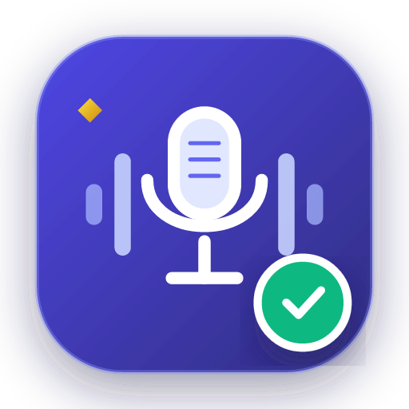
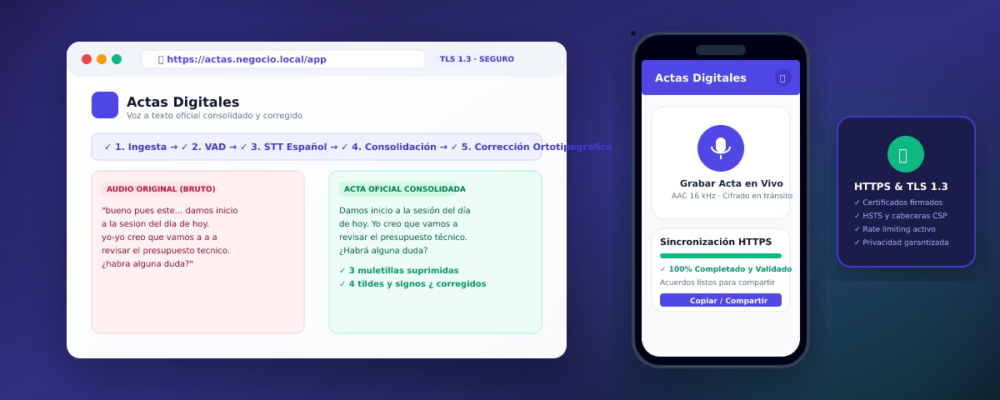

# Digital Minutes (Actas Digitales) · Speech to Official Corrected Text

# Actas Digitales

### Capture. Transcribe. Consolidate. Finalize.

**End-to-end Spanish speech-to-text platform with oral artifact cleaning, deduplication, and spelling/grammar correction for meeting minutes.**
**Installable Web app (PWA), native Kotlin Android app, and self-hosted HTTPS server.**

🌐 **[Project Website](https://yhquintero.github.io/Actas_Digitales/) · [User Manual (Printable)](../MANUAL_USUARIO.html) · [Quick Guide](../GUIA_RAPIDA.md) · [3-Min Promo Video](../PROPUESTA_VIDEO_PROMOCIONAL.md)**

  

---

## 🧭 Overview

**Actas Digitales** solves the problem of manual transcription of board meetings, technical committees, and official assemblies. Users upload an audio file or record directly from their microphone (via Web or Android). The system extracts phonetic speech in Spanish, deduplicates overlapping slices, removes oral filler words (*"este..."*, *"o sea"*, stutters), and corrects spelling and punctuation (`¿`, `¡`, accents) before outputting an official document ready for signatures.

| Project Sheet | Details |
|---|---|
| **What it is** | Full-stack Spanish speech-to-text pipeline with NLP consolidation and correction |
| **Who it's for** | Board secretaries, executives, legal counsel, committee members, and auditors |
| **Tech Stack** | Python 3.11 (FastAPI + Celery/Redis) · React 18 + TS (Vite) · Kotlin (Jetpack Compose + WorkManager) · Cryptography (TLS 1.3) |
| **Where it runs** | Self-hosted Linux/Windows/Docker server or private cloud |
| **Security** | TLS 1.3 signed certificates with SAN, HSTS, CSP headers, rate-limiting, and 100% private data isolation |

---

## 🧩 Ecosystem

1. **Web App (PWA):** React 18 with TypeScript. Features in-browser microphone recording, drag-and-drop file upload, live 5-step pipeline progress, side-by-side Before/After diff, and PDF/TXT export.
2. **Android App (Native Kotlin):** Built with Jetpack Compose and Material 3. Captures 16 kHz AAC audio and uses **WorkManager** for resilient background uploads that survive network drops.
3. **HTTPS Server (FastAPI):** Python backend serving API and Web SPA with signed TLS certificates, Spanish NLP consolidation engine, and pluggable support for OpenAI Whisper / Groq or local models.

---

## 🔒 Security & HTTPS

- Automated X.509 v3 signed certificates with Subject Alternative Names (SAN) for `localhost`, `127.0.0.1`, and enterprise hostnames.
- `Strict-Transport-Security: max-age=31536000; includeSubDomains; preload`
- Rate-limiting middleware mitigating denial-of-service attempts.
- Android Network Security Config supporting system and enterprise user-installed CAs.

---

<b>Actas Digitales</b> · © 2026 yhquintero · <a href="#">Back to top ⬆</a>

